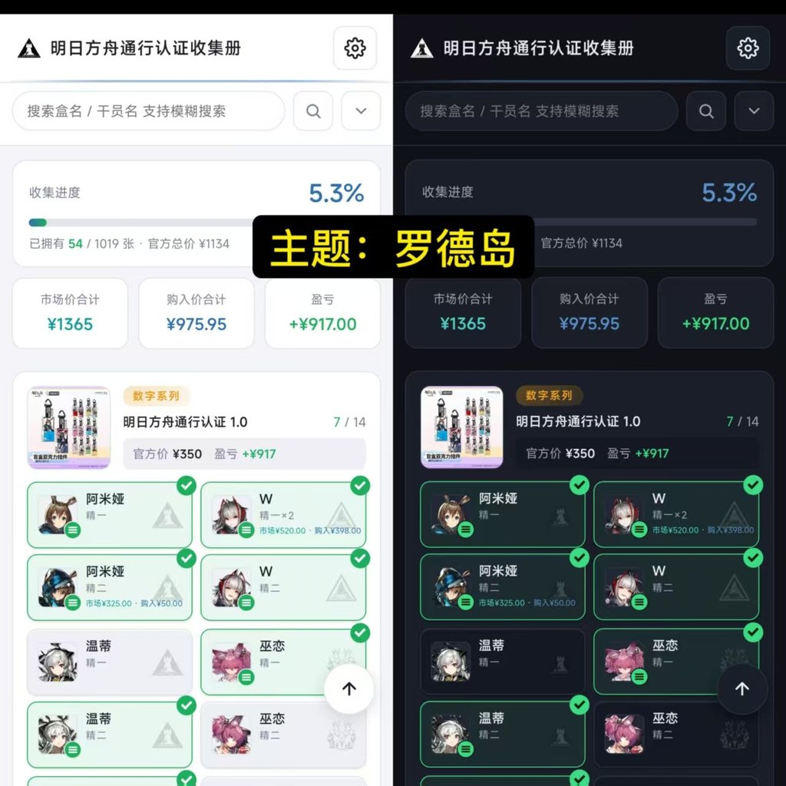
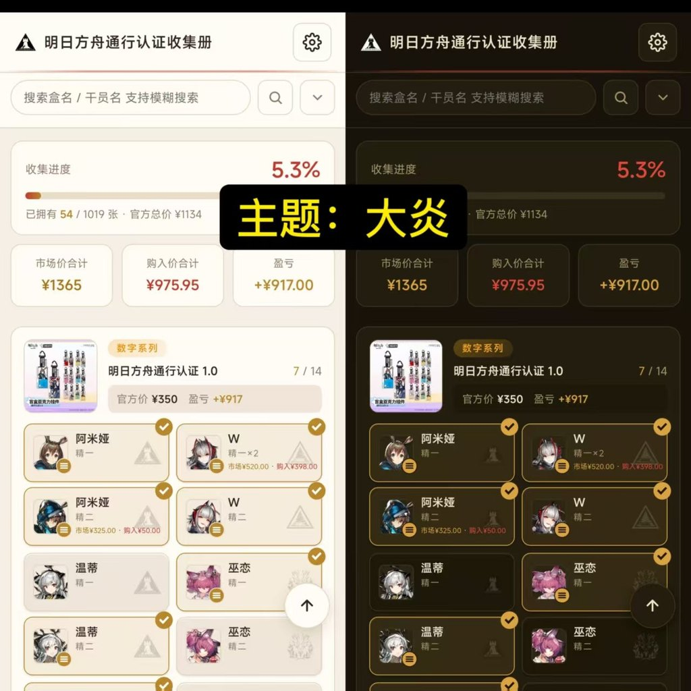
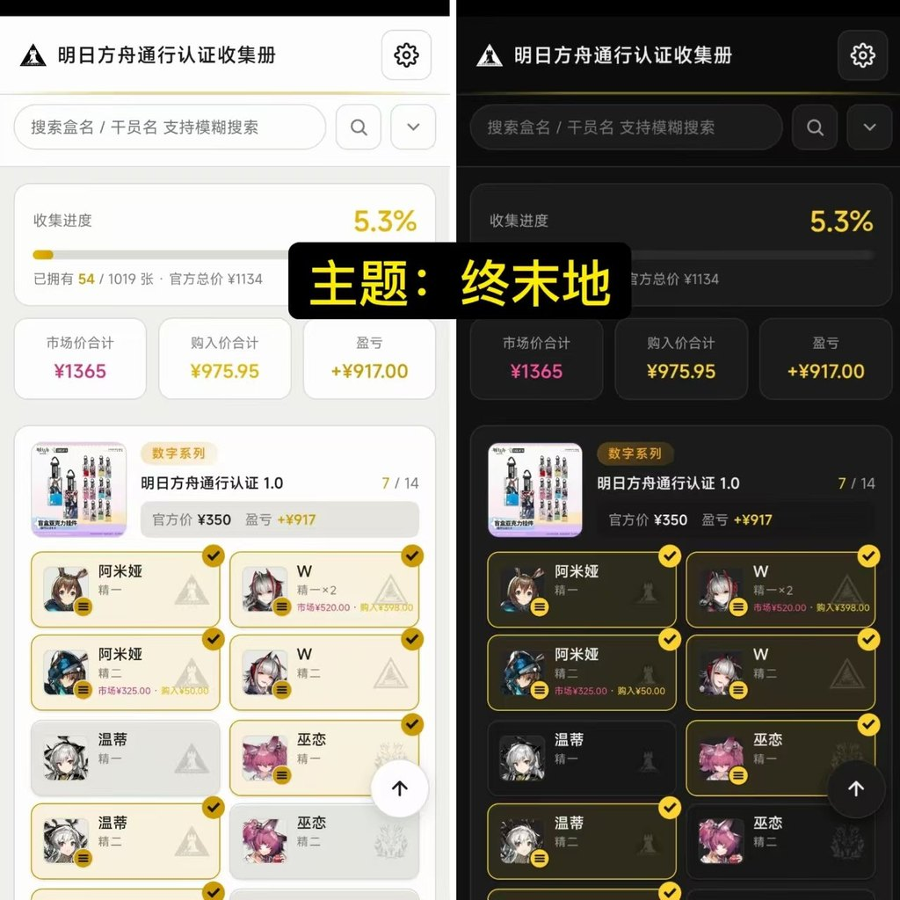
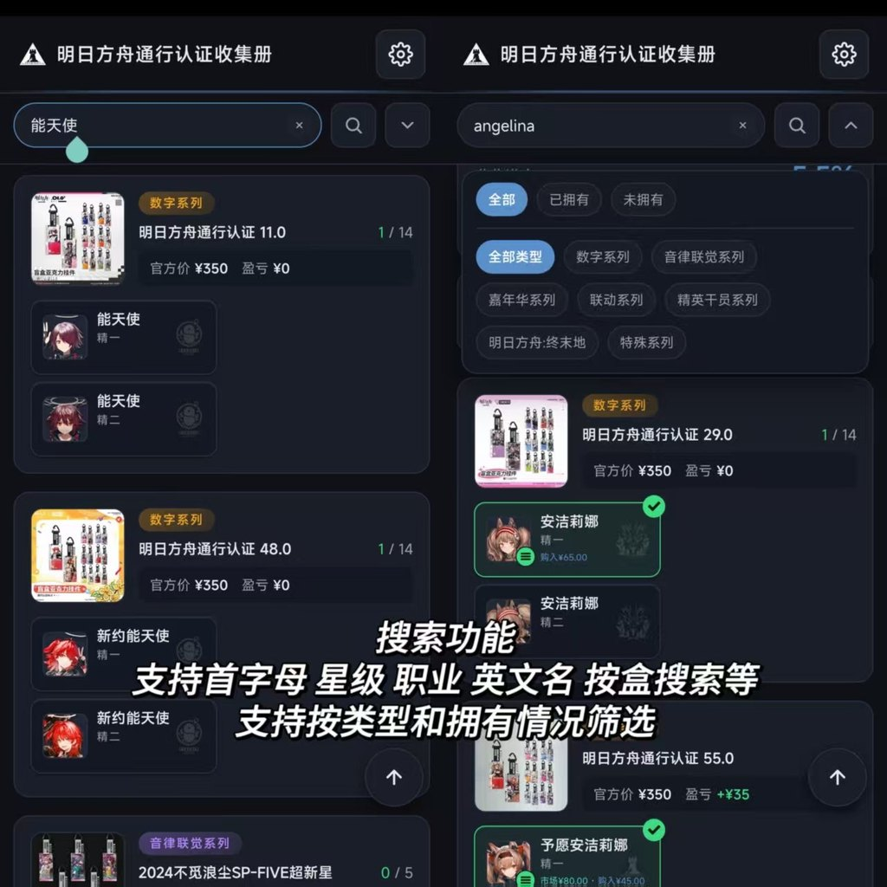
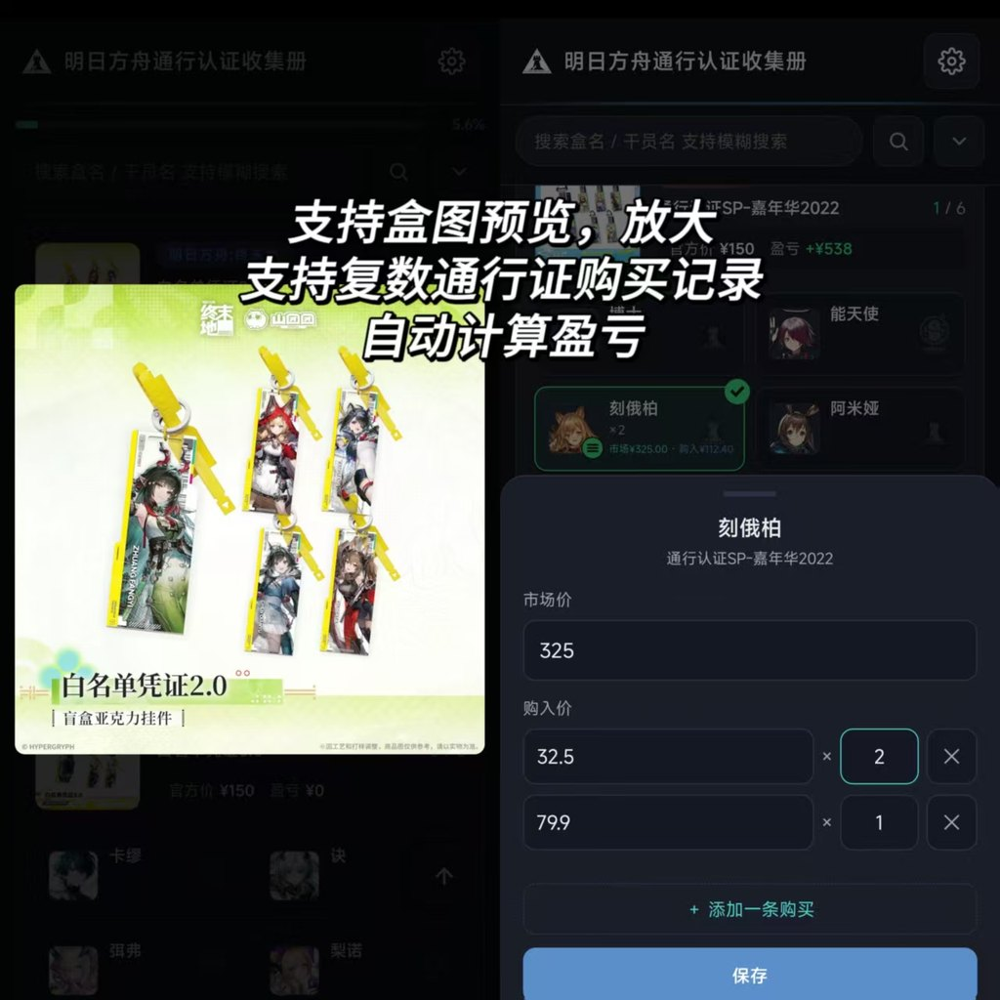
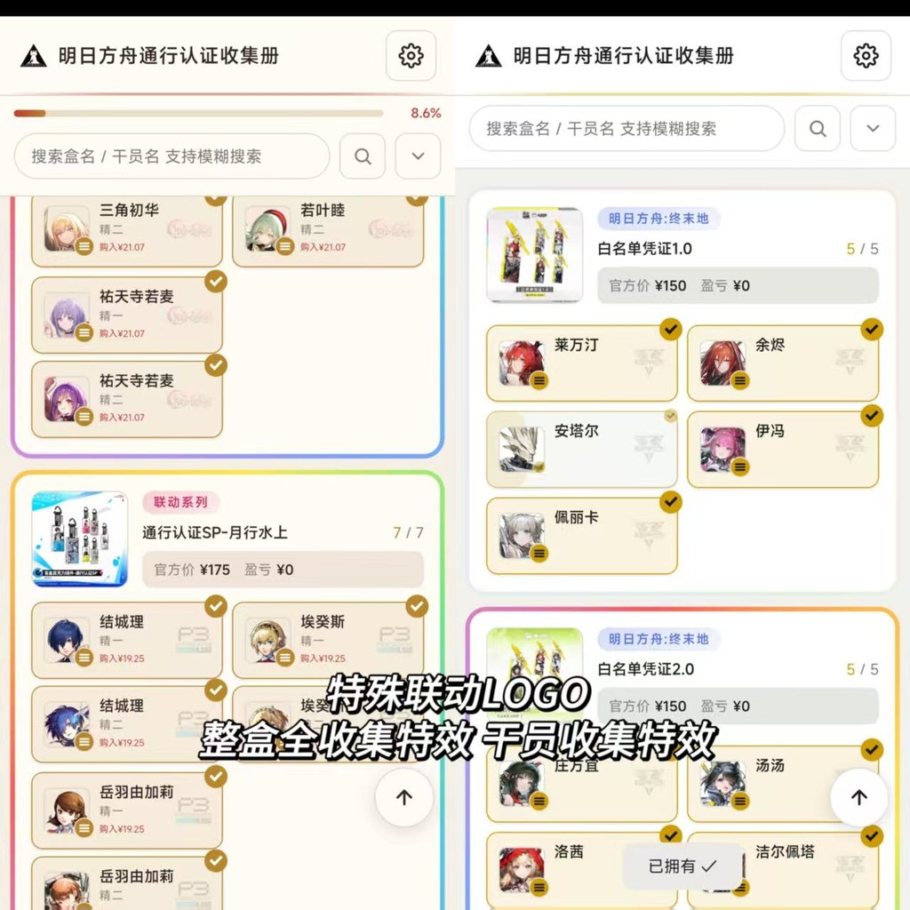
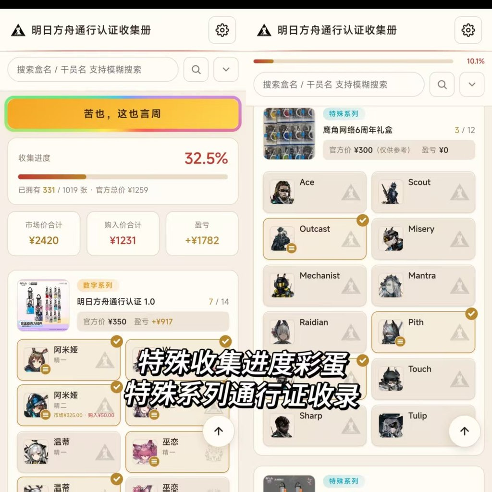
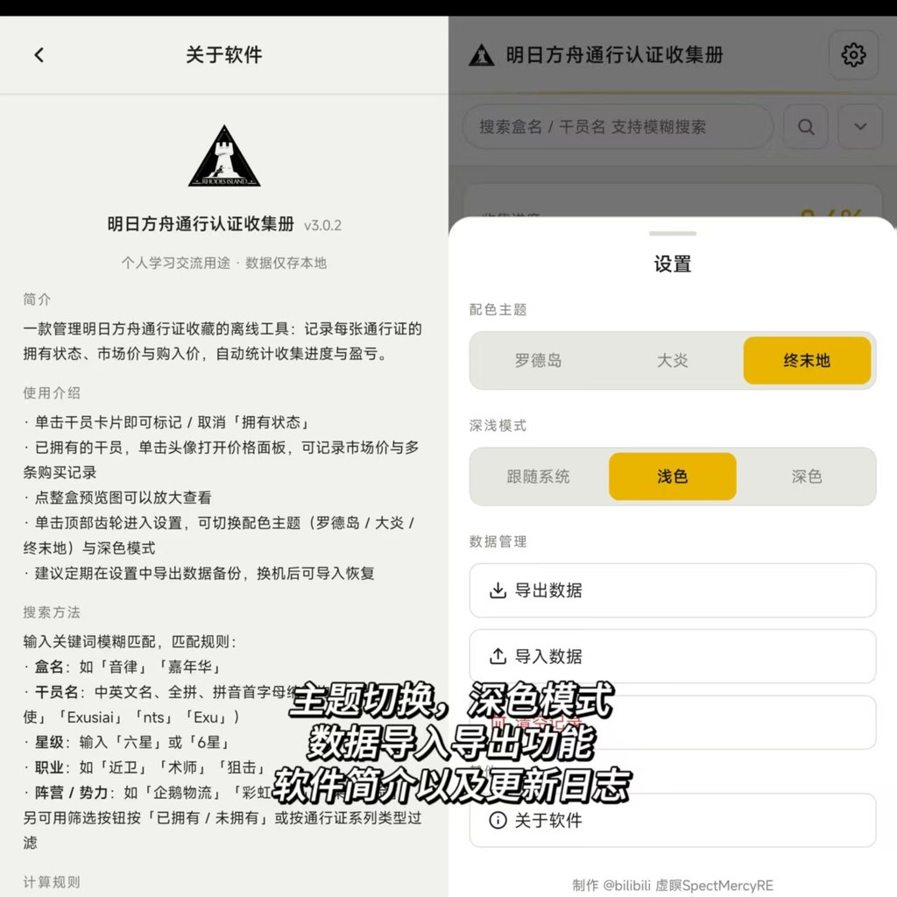
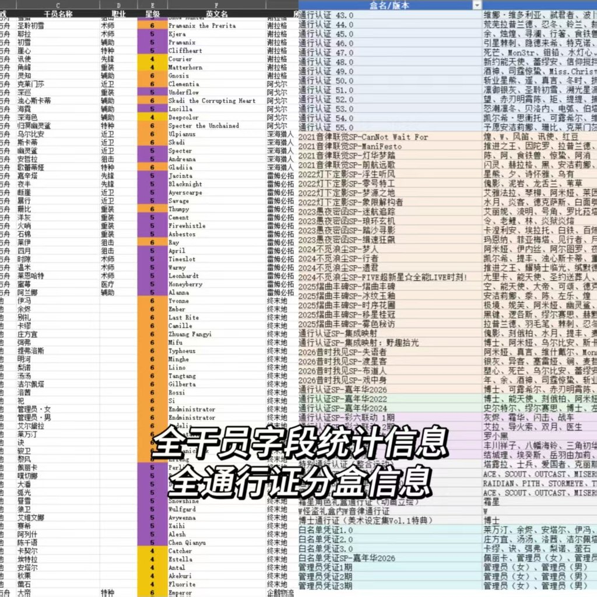

# 明日方舟·通行认证收集册

<p align="center">
  
</p>

一款管理《明日方舟》《明日方舟:终末地》通行认证收藏的**离线工具应用**，基于 **Capacitor** 打包为安卓客户端。

记录每张通行证的拥有状态、市场价与购入价，自动统计收集进度与盈亏  
支持按盒名/干员名/英文名/拼音首字母/星级/职业/势力搜索  
包含三套配色主题（罗德岛 / 大炎 / 终末地），支持深色模式

> [!IMPORTANT]
> 本仓库**不包含游戏素材**（干员头像、预览图、势力图标），版权归**上海鹰角网络科技有限公司**所有，不在本项目的 MIT 授权范围内。
> 缺少素材时，应用会正常运行，图片位置会显示占位符，请自行准备 `arknights-pass/images/` 目录。
>
> 本项目为**非官方的个人学习交流作品**，禁止任何商业用途。详见 [版权与免责声明](DISCLAIMER.md)。

## 下载

安卓安装包见本仓库的 [Releases](../../releases/latest) 页面

> [!NOTE]
> Release 里的 APK 由本地构建，**包含游戏素材**，可直接安装使用。

## 功能

· 单击干员卡片即可标记 / 取消「拥有状态」  
· 已拥有的干员，单击头像打开价格面板，可记录市场价与多条购买记录  
· 点整盒预览图可以放大查看  
· 单击顶部齿轮进入设置，可切换配色主题（罗德岛 / 大炎 / 终末地）与深色模式  
· 建议定期在设置中导出数据备份，换机后可导入恢复

## 界面预览

### 三套配色主题（每套均含浅色 / 深色）

| 罗德岛 | 大炎 | 终末地 |
|:---:|:---:|:---:|
|  |  |  |

### 搜索与筛选

支持盒名、干员中英文名、全拼、拼音首字母、星级、职业、阵营势力；可按拥有状态与系列类型过滤。

<p></p>

### 价格、复数购买与盈亏

点开整盒预览图可放大查看；同一张通行证支持记录多条购买记录（各带购入价与数量），盈亏自动计算。

<p></p>

### 收集特效

整盒收齐点亮流动彩虹边框，联动系列使用专属 LOGO，勾选时有水波与角标动画。

<p></p>

### 进度彩蛋与特殊系列

收集进度到特定数字会触发隐藏横幅；精英干员、周年礼盒等特殊系列单独成盒收录。

<p></p>

### 设置与关于

主题切换、深浅模式、数据导入导出，以及完整的软件简介与更新日志。

<p></p>

### 数据来源

干员字段（职业 / 星级 / 英文名 / 势力）与通行证分盒归类，来自逐条整理的源表：

<p></p>

## 技术栈

- 前端：HTML/CSS/JavaScript
- 数据：`arknights-pass/data.js` 由 Python 脚本从数据源生成
- 客户端：Capacitor 6（Android）
- 数据生成：Python + openpyxl + Pillow + pypinyin

## 目录结构

```
arknights-pass/          # 前端源码
  index.html             #   单文件应用
  data.js                #   系列/干员/价格/势力Logo数据
  images/                #   未包含在仓库中，需自行准备
_rebuild.py              # 数据重建脚本：Excel 源表 → data.js + 图标处理
_make_icon.py            # 应用图标生成脚本：源图 → Android mipmap
build_apk.py             # 一键构建：同步 www → 调用 Gradle 打包 APK
docs/screenshots/        # README 用的界面截图与应用图标
app/                     # Capacitor 安卓工程（app/www 由脚本同步，请勿修改）
```

### 素材说明

`arknights-pass/images/` 需要以下子目录（文件名与代码中的调用一致）：

- `images/avatar/` — 干员头像，命名 `干员名-精一.png` / `干员名-精二.png`
- `images/faction/` — 势力图标，命名 `势力名.png`（浅色模式）、`势力名_w.png`（深色模式）
- `images/*.jpg` — 整盒预览图，文件名即系列名
- `images/logo.png` — 关于页Logo

缺失的图片会自动显示为「暂无图片」占位，不影响其他功能。

## 构建

### 前置环境

- Python 3.11+（数据重建，依赖 `openpyxl`、`Pillow`、`pypinyin`）
- Node.js 18+
- JDK 17（Gradle 8.2.1 不支持 Java 21+，`app/android/gradle.properties` 已固定 `org.gradle.java.home`）

### 步骤

```bash
# 1. 安装前端工程依赖（Capacitor 插件）
cd app && npm install && cd ..

# 2. 同步 Capacitor 配置与插件到安卓工程（首次构建，或改了 capacitor.config.json 之后）
cd app && npx cap sync android && cd ..

# 3. 生成应用图标（仓库未包含图标素材，首次构建的时候必须要做嗷）
#    准备一张自己的icon
python _make_icon.py <图标源图路径>

# 4. 一键打包（自动同步 www 与安卓 assets，再调用 Gradle）
python build_apk.py
```

产物：`app/android/app/build/outputs/apk/debug/app-debug.apk`（脚本会同时复制一份 `通行认证收集册-v<版本>.apk`）

### 数据更新（可选）

修改 `_rebuild.py` 顶部的 Excel 源表路径后运行：

```bash
python _rebuild.py      # 重新生成 data.js 与图片资源
python _make_icon.py <图标源图>   # 更换应用图标
```

## 数据来源与致谢

- 通行证整盒缩略图（1.0 ~ 55.0 主线系列）：小红书 @KJCJS 老师 整理资料
- 通行证干员分布：Bilibili @燎冬谣 老师 整理资料
- 干员英文名 / 势力 / 职业 / 星级：明日方舟终末地森空岛 wiki、PRTS wiki

## 版权声明

《明日方舟》《明日方舟：终末地》及相关名称、美术素材版权归**上海鹰角网络科技有限公司**所有。
本项目为非盈利的个人学习交流作品，素材仅用于展示收藏管理功能，不作任何商业用途。如有侵权，请联系删除。

## 许可证

- **代码**：[MIT License](LICENSE) — 可自由使用、修改、分发
- **第三方内容不在 MIT 授权范围内**，版权归各原权利人所有，详见 [版权与免责声明](DISCLAIMER.md)
- **禁止商业用途**：本项目及其任何衍生版本均不得用于售卖、付费服务、广告变现、周边制作等任何商业场景。

## Changelog

Newest first. Version numbers track the app version.

### v3.0.2
- Fixed cards popping back in when toggling one while a search or filter was active.
- The clear (×) button in the search box no longer pulls up the keyboard.

### v3.0.1
- Image preview got pinch-to-zoom and drag. System back closes it.

### v3.0.0
- Rewrote the card rendering core. Every animation now plays the way it was meant to.

### v2.4.2
- System back button / back gesture closes panels properly and exits the app when there's nothing left open.
- Fixed an intermittent animation glitch.

### v2.4.1
- Cleaned up the price sheet and the search / filter UI.
- Fixed the Rainbow Squad logo washing out on light backgrounds.
- Fixed an intermittent animation glitch.

### v2.4.0
- New app icon.
- More consistent card height.
- Search box gained a magnifier and a clear button; search only runs on click or Enter.
- Adding a purchase record no longer opens the keyboard by itself.
- Frostnova / Doctor / Ace / Scout / Outcast / Mantra now count as Rhodes Island. Tweaked the Ave Mujica watermark size.
- Fixed an intermittent animation glitch.

### v2.3.5
- Small stuff. Let's call it UX polish.

### v2.3.4
- Moved things around on the operator card.
- Reworked the toggle animation, added panel expand / collapse and card reveal animations.
- Search can now match faction. Trimmed the placeholder text.
- Rebuilt the Endfield theme.
- All faction icons normalized to a single size.

### v2.3.3
- Every operator has an English name and a faction now, so English search works across the board.
- Faction watermark in the corner of each card, with separate light / dark logos.
- Search can now match class.

### v2.3.2
- Redesigned the app icon.

### v2.3.1
- P/L fix: operators without a market price no longer skew the profit total.
- Search and filter now work per operator instead of expanding whole boxes.
- Added English names for Endfield operators.
- Search can match English name, full pinyin and initials.

### v2.3.0
- Added the Yan and Endfield color themes, both with light / dark variants.
- Version numbers now track the app version.
- Added card enter / exit, toggle, and full-box rainbow animations.
- Cleaned up a batch of UI behaviors.

### v2.2.7
- Fixed prices not being saved when nothing was actually edited.

### v2.2.6
- Added star ratings for all Endfield operators; Endfield passes can be searched by star.

### v2.2.5
- Quantity input now starts at 1. An empty price with a quantity saves as ¥0.
- Amounts of ¥100,000,000 and above roll over to 亿.
- Wording tweaks.
- Filter bar starts collapsed, and the header shows progress while scrolling.

### v2.2.4
- Renamed a few operators.
- Tidied up the operator card layout.
- Search can now match star rating.
- Fixed the keyboard being dismissed mid-typing in the search box.

### v2.2.3
- Export now opens the system share sheet. Fixed export doing nothing on Android.

### v2.2.2
- Added the Emperor avatar. Documented how special operators share one dataset.

### v2.2.1
- Ambience Synesthesia and Carnival passes reuse the base operator's E1 avatar.
- Endfield avatars baked in. Avatar library reached 841 images.

### v2.2.0
- All box preview images are in (106 boxes).
- Added avatars for Reunion, the Elite Ops (Ace / Scout / Outcast / Mantra), Frostnova and the Doctor.
- Added two Endfield boxes: Admin Credential Beta and Admin Credential 4.

### v2.1.5
- Reordered the browsing page by category (numbered → Ambience → Carnival → Collab → Elite → Special → Endfield).
- Boxes within a tag are now sorted by release year.

### v2.1.4
- Fixed three misspelled operator names.

### v2.1.3
- Operator names always match the in-game spelling now.
- Went back over how every pass is grouped into boxes.
- Added box prices for Frostnova / W / the art book.

### v2.1.2
- Fixed Endfield official prices so the totals add up.

### v2.1.1
- Endfield whitelist and admin credentials now count toward the official price total.

### v2.1.0
- Rebuilt the whole dataset: pass statistics (104 boxes), 463 operators with class and star, operator avatars and faction icons.
- Fuzzy matching for aliases (U-Official, 塑心 and friends).

### v2.0.3
- Added the Elite Ops and Arknights: Endfield categories.

### v2.0.2
- Filled in the missing changelog entries.

### v2.0.1
- About screen went from a bottom drawer to a full page.
- Added a proper icon set for the UI.
- Price input drops trailing zeros.

### v2.0.0
- Duplicates: one operator can hold several purchase records, each with its own price and quantity.
- All totals (official / market / paid / P/L) are quantity-aware now.
- Cards show a ×N badge when duplicates exist.
- Old backups still import.

### v1.5.2
- Normalized the numbered series titles. Added box thumbnails for 1.0–55.0.

### v1.5.1
- Two amount formats: the header rolls over to 亿 with two decimals, card prices drop decimals at 万.
- Type and layout tweaks.

### v1.5.0
- Amounts of 10,000 and above auto-convert to 万 instead of overflowing. Price input caps at 3,250,000.

### v1.4.4
- Two easter eggs. Have fun finding them.

### v1.4.3
- The hamburger button moved from the card corner to the avatar corner, and tapping the avatar edits prices directly.

### v1.4.2
- Single-box titles got a smaller size so long names fit.
- More formal wording on the price labels.

### v1.4.1
- Box header became three lines (tag / name / price). Prices keep only official and P/L.
- Re-laid out the operator card text.
- ~~Operator names auto-shrink to fit.~~ Reverted.

### v1.4.0
- Price input takes integers or two decimals only, and can't go negative.
- UI cleanup. Fixed price labels stacking vertically on unusual aspect ratios.

### v1.3.2
- ~~Long box names and price rows auto-shrink instead of wrapping.~~ Reverted.

### v1.3.1
- ~~Long operator names auto-shrink instead of wrapping.~~ Reverted.

### v1.3.0
- New color scheme. Cards got glossy highlights and shadows.

### v1.2.3
- Performance pass: smoother toggling, less stutter.

### v1.2.2
- Layout tweaks. Added a back-to-top button.

### v1.2.1
- Cleaned up the operator and box card layouts. Logos auto-invert in light mode.

### v1.2.0
- Added operator avatars. Reworked the dataset and the search logic.

### v1.1.4
- Un-toggling an operator that already has prices now asks for confirmation.

### v1.1.3
- More data: Carnival and collab series. Slimmed down the price sheet.

### v1.1.2
- Added the About panel.

### v1.1.1
- Tap a card to toggle ownership directly.

### v1.1.0
- Light / dark / follow-system modes and a settings screen.
- Fixed cards misaligning inside a box. Moved the search box.

### v1.0.2
- Layout fixes. Fancier progress bar.

### v1.0.1
- New single-box layout and filter tag layout. Search by box or operator name.

### v1.0.0
- Mobile rewrite. Reworked the overall layout and interaction model.

### v0.9
- Prices are per pass now: each one tracks its own market and paid price. Added P/L and a full-size thumbnail view.

### v0.8
- Ambience Synesthesia (SP) data, sliced from box art.

### v0.7
- First test data, sliced from box art.

### v0.6
- Collection progress bar. Layout changes.

### v0.5
- Layout and visual polish.

### v0.4
- Collab operator data.

### v0.3
- Dataset cleanup.

### v0.2
- Passes are shown per box, one box per series, with an editable market price.

### v0.1
- First web release: operator cards, ownership toggles, filters, stats, import / export.
